# Serverless Image Processing Pipeline with S3, SQS and Lambda

An event-driven image pipeline built on AWS using the Management Console. A user uploads an image to a private S3 bucket. The upload creates an event in SQS. A Lambda function reads the queue, resizes the image to 800 px wide, adds a watermark, and saves the result in a second private S3 bucket. CloudFront delivers the processed image over HTTPS.

**Region:** us-east-1 for every resource.
**Built by:** Moiz, BSCS final-year student, as part of the Manara Tech AWS Serverless course project.

## Table of Contents
- [Architecture Diagram](#architecture-diagram)
- [How It Works](#how-it-works)
- [Lambda Code](#lambda-code)
- [How to Use It](#how-to-use-it)
- [Repository Structure](#repository-structure)
- [AWS Services Used](#aws-services-used)
- [Resource Names](#resource-names)
- [Test Evidence](#test-evidence)

## Architecture Diagram

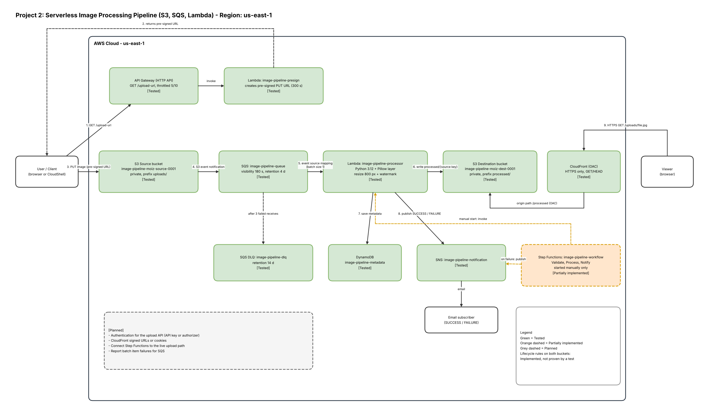

Colour code: green = tested, orange dashed = partially implemented, grey dashed = planned. The editable draw.io source is in [`docs/image-pipeline-architecture.drawio`](docs/image-pipeline-architecture.drawio).

## How It Works

1. The client calls `GET /upload-url` on an API Gateway HTTP API.
2. The `image-pipeline-presign` Lambda returns a pre-signed S3 PUT URL that is valid for 300 seconds.
3. The client uploads the image to the source bucket under `uploads/`.
4. An S3 event notification (`image-upload-to-sqs`) sends a message to `image-pipeline-queue`.
5. The `image-pipeline-processor` Lambda reads the message (batch size 1), resizes the image to 800 px wide and adds a watermark.
6. The result is written to the destination bucket as `processed/<original key>`. The same key is used every time, so a retry or duplicate message overwrites the same file instead of creating copies.
7. The Lambda saves the metadata in DynamoDB and sends a SUCCESS or FAILURE message to SNS, which emails the subscriber.
8. If a message fails 3 times, SQS moves it to the dead-letter queue (`image-pipeline-dlq`).
9. A viewer opens `https://<cloudfront-domain>/uploads/<file>.jpg`. CloudFront reads from the destination bucket with Origin Access Control.

## Lambda Code

| Function | File | What it does |
|---|---|---|
| `image-pipeline-processor` | [`lambda/processor/lambda_function.py`](lambda/processor/lambda_function.py) | Reads the S3 event from the SQS message, downloads the image, fixes rotation (EXIF), resizes to a maximum width of 800 px, writes the text watermark, saves JPEG (quality 85) or PNG, then saves metadata to DynamoDB and sends an SNS email. |
| `image-pipeline-presign` | [`lambda/presign/lambda_function.py`](lambda/presign/lambda_function.py) | Accepts `?filename=`, allows only `.jpg`, `.jpeg` and `.png`, cleans the name, builds the key `uploads/<8 random chars>-<name>` and returns a 300 second pre-signed PUT URL. |

Design choices in the processor:
- It skips the `s3:TestEvent` message that S3 sends when the notification is created, and skips files that are not images.
- The output key is always `processed/<source key>`, so a retry or a duplicate message overwrites the same file.
- If image processing fails, it sends a FAILURE email and raises the error again, so SQS retries the message and finally moves it to the DLQ.
- Saving metadata and sending SNS messages never raise errors, so a problem in those services cannot block image processing.
- The SNS topic ARN is read from the environment variable `SNS_TOPIC_ARN`. No secrets are stored in the code.

Metadata saved in DynamoDB: `source_key`, `source_bucket`, `dest_bucket`, `dest_key`, original and processed width, height and bytes, `status` and `processed_at`.

## How to Use It

1. Ask the API for an upload URL. Replace `<API_ENDPOINT>` with your own API URL:
   ```
   curl "<API_ENDPOINT>/upload-url?filename=photo.jpg"
   ```
   The answer contains `upload_url`, `key`, `expires_in_seconds` and `method`.
2. Upload within 300 seconds:
   ```
   curl -X PUT --upload-file photo.jpg "<upload_url from step 1>"
   ```
   HTTP 200 means the upload worked. Do not post the pre-signed URL anywhere public.
3. Wait a few seconds. The processed image appears in the destination bucket and can be opened at:
   ```
   https://<cloudfront-domain>/<key from step 1>
   ```
   For example `https://<cloudfront-domain>/uploads/8a0d9079-fsc.jpg`.

## Repository Structure

```
serverless-image-pipeline/
├── README.md
├── lambda/
│   ├── processor/lambda_function.py
│   └── presign/lambda_function.py
└── docs/
    ├── architecture.png
    ├── image-pipeline-architecture.drawio
    └── screenshots/
```

## AWS Services Used

| Service | Purpose in this project |
|---|---|
| Amazon S3 (source) | Receives the uploaded originals. Private, lifecycle rule attached. |
| Amazon S3 (destination) | Stores processed images. Private, lifecycle rule attached. |
| Amazon SQS | Decouples the upload from the processing and allows retries. |
| SQS dead-letter queue | Keeps messages that failed 3 times so they can be inspected. |
| AWS Lambda (processor) | Resizes and watermarks images with Pillow. |
| Lambda layer | Packages Pillow for Python 3.12 (`pillow-py312-x86`, version 1). |
| AWS Lambda (presign) | Creates short-lived pre-signed upload URLs. |
| Amazon API Gateway (HTTP API) | Public endpoint `GET /upload-url`, throttled. |
| Amazon DynamoDB | Stores image metadata (on-demand table). |
| Amazon SNS | Email notification for success or failure. |
| Amazon CloudFront | Delivers processed images over HTTPS. |
| AWS Step Functions | Standard workflow: validate, process, notify. Started manually. |
| AWS IAM | Least-privilege roles for the Lambdas and the state machine. |
| Amazon CloudWatch Logs | Lambda logs, used to confirm retries and errors. |

## Resource Names

| Type | Name |
|---|---|
| Source bucket | `image-pipeline-moiz-source-0001` |
| Destination bucket | `image-pipeline-moiz-dest-0001` |
| Queue | `image-pipeline-queue` (visibility timeout 180 s, retention 4 days) |
| Dead-letter queue | `image-pipeline-dlq` (retention 14 days, max receives 3) |
| S3 event notification | `image-upload-to-sqs` (prefix `uploads/`) |
| Processor Lambda | `image-pipeline-processor` (Python 3.12, x86_64, 512 MB, 30 s) |
| Presign Lambda | `image-pipeline-presign` |
| API | `image-pipeline-upload-api`, route `GET /upload-url`, throttling rate 5 / burst 10 |
| DynamoDB table | `image-pipeline-metadata` (key `source_key`, on-demand) |
| SNS topic | `image-pipeline-notification` |
| CloudFront distribution | `image-pipeline-cdn` (OAC, origin path `/processed`) |
| State machine | `image-pipeline-workflow` (Standard) |
| IAM roles | `image-pipeline-lambda-role`, `image-pipeline-presign-role-hup1gicx`, `StepFunctions-image-pipeline-workflow-role-znaam3v4s` |

## Test Evidence

Account ID, email and API ID are masked as XXXX in every screenshot.

### 1. Infrastructure

| Screenshot | What it shows |
|---|---|
| 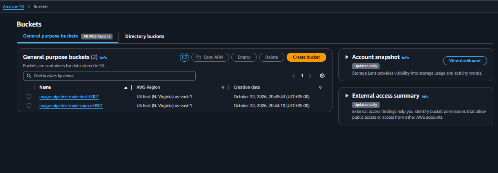 | Two separate private buckets in us-east-1 |
| 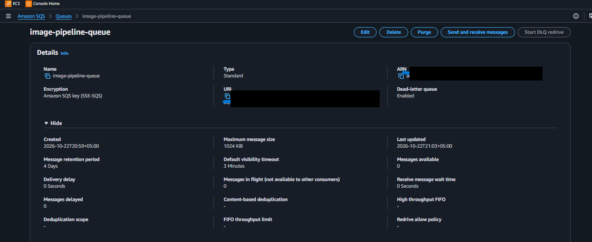 | Queue with a 180 s visibility timeout and 4 day retention |
| 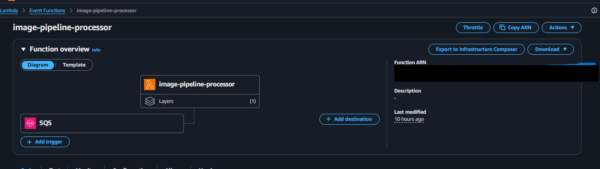 | Processor Lambda with the SQS trigger |
| 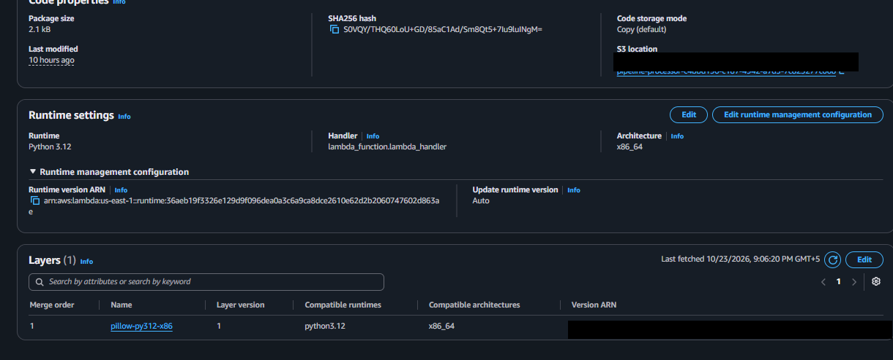 | Pillow layer `pillow-py312-x86:1` |

### 2. Core pipeline test

| Screenshot | What it shows |
|---|---|
| 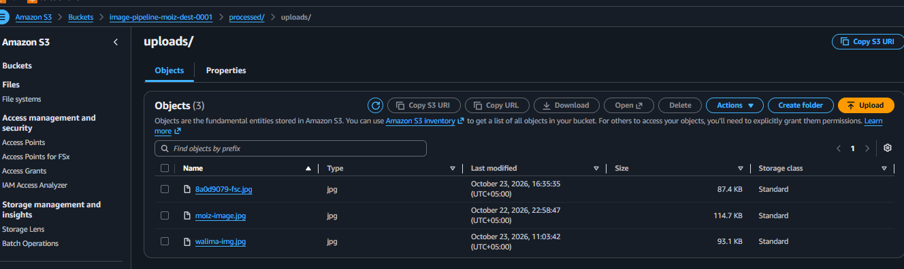 | Processed file in the destination bucket |

Before and after for the first test image `moiz-image.jpg`: the original had no watermark and was 853x1280 pixels (92.5 KB). The processed image is 800x1200 pixels (114.7 KB) and has the watermark "Moiz Image Pipeline" in the bottom right corner (visible in the CloudFront screenshot below). This test image was already compressed before upload, so its size did not reduce further. Larger photos reduce a lot in size.

Results:

| Input | Output |
|---|---|
| `moiz-image.jpg`, 853x1280, 92.5 KB | 800x1200, 114.7 KB, watermark visible |
| Large photo `walima-img.jpg`, 5472x3648, 2.8 MB | 800x533, 93.1 KB |

### 3. Failure handling

A fake file named `bad-image.jpg` (not a real image) was uploaded. Lambda failed 3 times with `UnidentifiedImageError`, about 180 seconds apart. After the third receive, SQS moved the message to the dead-letter queue.

| Screenshot | What it shows |
|---|---|
| 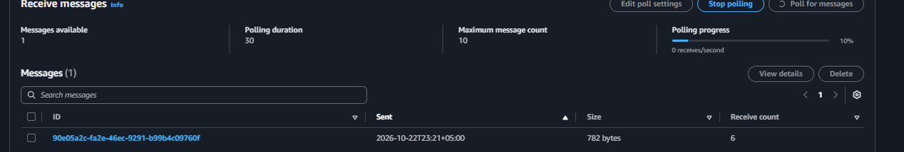 | The failed message waiting in the DLQ (the receive count is higher than 3 because the console polling also counts as a receive) |
| 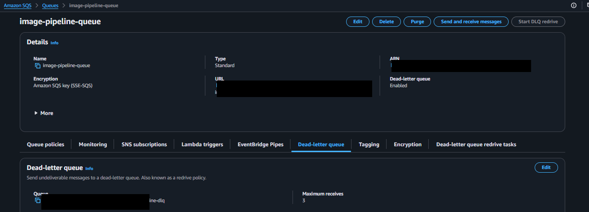 | Dead-letter queue with maximum receives = 3 |
| 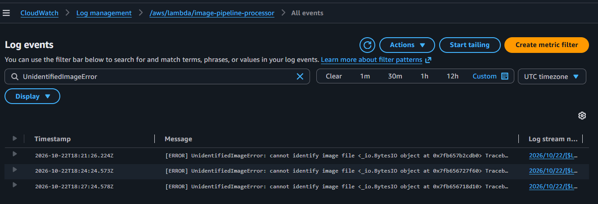 | Three `UnidentifiedImageError` log lines |

### 4. API upload and delivery

The API returned a pre-signed PUT URL (valid 300 s). `FSC.jpg` was uploaded from CloudShell with HTTP 200 and became `processed/uploads/8a0d9079-fsc.jpg` at 800x563, 87 KB, watermarked. A SUCCESS email and a DynamoDB row were created. Pre-signed URLs are not shown anywhere in this repository.

| Screenshot | What it shows |
|---|---|
| 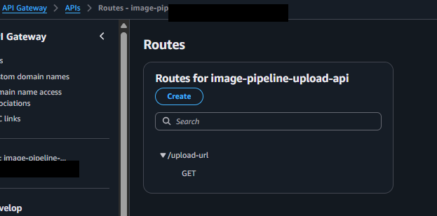 | `GET /upload-url` route |
| 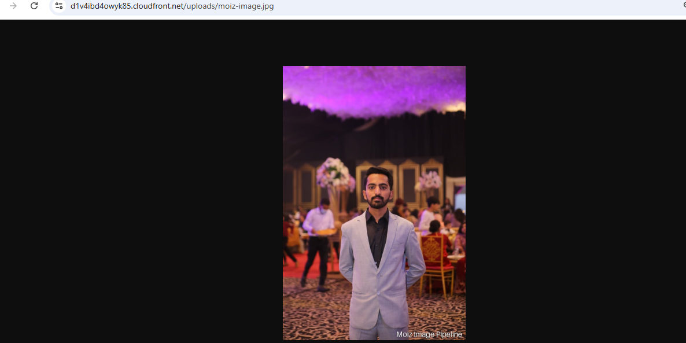 | Watermarked image served through CloudFront |
| 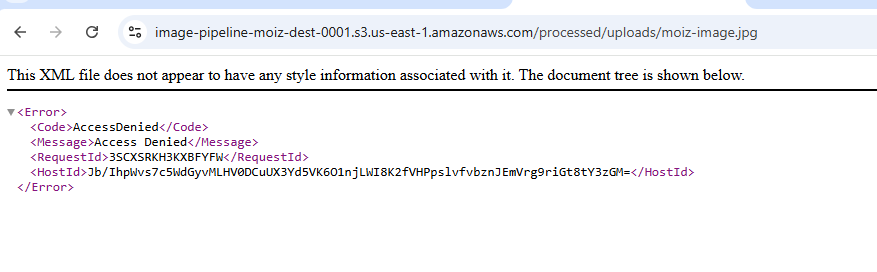 | Direct S3 URL returns AccessDenied, so the bucket is private |
| 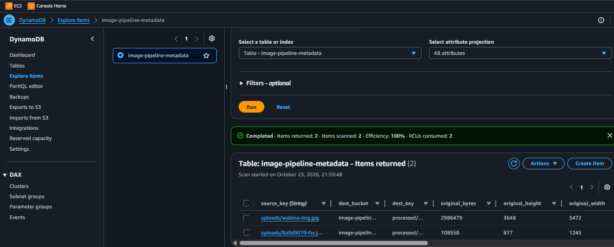 | Metadata rows for the large photo and the API upload |
| 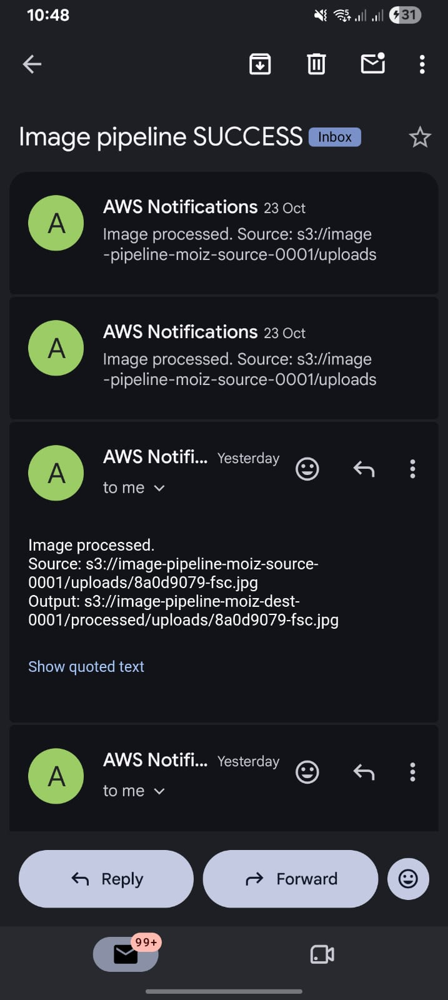 | SUCCESS notification emails from AWS Notifications, with the source and output file paths |

### 5. Step Functions and lifecycle rules

| Screenshot | What it shows |
|---|---|
| 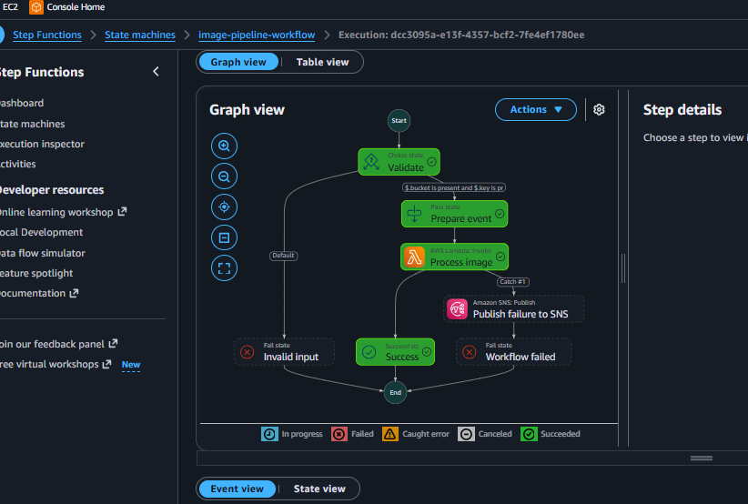 | Run 1 with a good image: Succeeded (output and email not confirmed) |
| 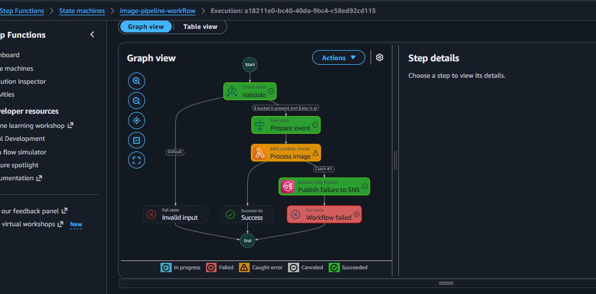 | Run 2 with a missing file: Failed as expected, failure published to SNS |
| 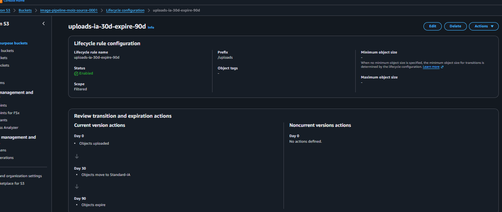 | Source bucket rule: Standard-IA after 30 days, expire after 90 days |
| 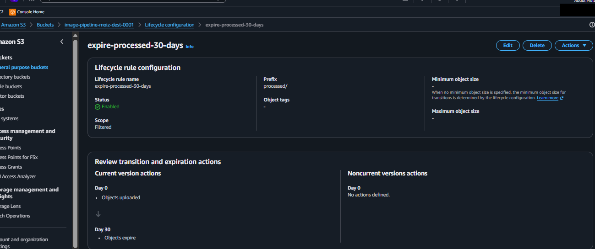 | Destination bucket rule: expire `processed/` after 30 days |

## License

For learning and portfolio use.
